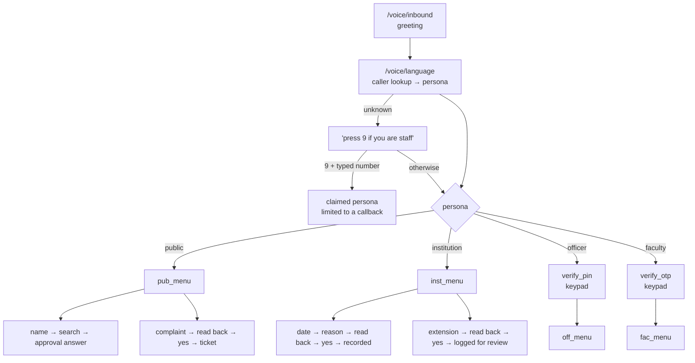

# AICTE Approval & Compliance Portal — AI Voice Agent

A phone-answering assistant for the AICTE Approval & Compliance Portal (SIH 2026, PS 26262).
People ring a phone number and talk to it; it can also be told to ring institutions about
overdue paperwork. This repository is **Track V — the voice service** (`apps/voice`). The rest of
the portal (web app, workflow engine, database — "Track P") is specified in [`app.md`](./app.md)
but is **not in this repo**; until it exists the voice service talks to a small built-in mock.

> **The short version:** open the dial pad page, type your phone number, press *Call me now* —
> the agent rings your phone and you talk to it. The conversation is a **fixed, testable graph of
> questions, with no OpenAI (or any LLM) in the call path**, spoken by a human-sounding streaming
> voice that you can interrupt. An LLM is an optional extra (`hybrid`/`relay` modes) and is off
> unless you give it a key.

---

## Contents

0. [**Start here: make the dial pad call you**](#start-here-make-the-dial-pad-call-you)
1. [What it does](#1-what-it-does)
2. [A call, start to finish (real output)](#2-a-call-start-to-finish-real-output)
3. [How it works](#3-how-it-works)
4. [What you need (accounts, keys, tools)](#4-what-you-need-accounts-keys-tools)
5. [Try it in five minutes — no Twilio needed](#5-try-it-in-five-minutes--no-twilio-needed)
6. [Take real phone calls (Twilio + ngrok)](#6-take-real-phone-calls-twilio--ngrok)
7. [Configuration reference](#7-configuration-reference)
8. [Safety rules the code enforces](#8-safety-rules-the-code-enforces)
9. [HTTP endpoints](#9-http-endpoints)
10. [Repository layout](#10-repository-layout)
11. [Tests](#11-tests)
12. [Status: what is and is not built](#12-status-what-is-and-is-not-built)
13. [Known limitations — read before a demo](#13-known-limitations--read-before-a-demo)

---

## Start here: make the dial pad call you

```
 you open the page            the page asks the service         the service asks Twilio
 gojosatorou999.github.io ──► POST /dial/call (via ngrok) ───► "ring this number"
        ▲                                                            │
        │ shows "Ringing… / Connected"                               ▼
        └──────── GET /dial/status ◄──── service ◄──────────── Twilio rings your phone
                                            ▲   you answer; Twilio fetches /voice/outbound-twiml
                                            └── then streams the call over a WebSocket (/voice/live)
```

The same idea as the earlier Sentinel dial pad: a public web page, a backend behind an ngrok
address, and Twilio doing the ringing. **Nothing has to be pasted into Twilio for this**: each call
carries its own webhook address, built from `PUBLIC_VOICE_URL`.

| What | Value |
|---|---|
| **Dial pad page** (GitHub Pages) | https://gojosatorou999.github.io/aicte-call/ |
| **Backend address** (your permanent ngrok address) | `https://rehydrate-alongside-shampoo.ngrok-free.dev` |
| **TwiML URL Twilio fetches when you answer** (built automatically per call) | `https://rehydrate-alongside-shampoo.ngrok-free.dev/voice/outbound-twiml?d=<id>` |
| Only if you also want to *receive* calls on the Twilio number: *A call comes in* → Webhook, POST | `https://rehydrate-alongside-shampoo.ngrok-free.dev/voice/inbound` |

### Do these once — where each thing goes

| # | Do this | Where | State |
|---|---|---|---|
| 1 | **Get a Twilio phone number** on your account (Phone Numbers → Manage → Buy a number; a trial includes one) | console.twilio.com | **You: needed.** The preflight found *no number* on the account whose credentials are in `.env` |
| 2 | Put that number, in `+E.164` form (e.g. `+14155552671`), in **`TWILIO_VOICE_NUMBER`** | `apps/voice/.env` | **You** |
| 3 | **Verify your own phone** so a *trial* account may call it (Phone Numbers → Manage → Verified Caller IDs → Add) | console.twilio.com | **You: needed on a trial account** |
| 4 | Allow calls to India: Voice → Settings → **Geo permissions** → tick *India* | console.twilio.com | **You: check** |
| 4b | **Switch on ConversationRelay** (the live, human-sounding voice): Console → Voice → Settings → **Privacy & Security** (older console: Voice → Settings → General) → accept the *Predictive and Generative AI/ML Features Addendum* → Save. A legal acceptance only the account owner can make. Without it, calls are answered and then end after ~1 second; the dial pad then says so | console.twilio.com | **You: needed for `live` mode** |
| 5 | `TWILIO_ACCOUNT_SID`, `TWILIO_AUTH_TOKEN` | `apps/voice/.env` | Done — Twilio accepted them |
| 6 | ngrok authtoken | stored by ngrok on this PC (`ngrok config add-authtoken …`) — **not in this project** | Done |
| 7 | Backend address | `PUBLIC_VOICE_URL` in `apps/voice/.env` **and** `api` in `dialpad/config.js` | Done (both set) |
| 8 | Optional access code so strangers can't use your page: set `DIAL_PAD_TOKEN` | `apps/voice/.env` | Recommended before you share the link |

### Every time you demo

```powershell
.\scripts\start_all.ps1        # starts the stand-in backend, the voice service and the ngrok tunnel,
                               # then runs a read-only check and tells you anything still missing
```
Then open the dial pad page, enter your number, press **Call me now**, and answer. Stop everything
with `.\scripts\start_all.ps1 -Stop`. The check can be run alone: `python scripts/check_setup.py`.

On the page you can also pick a **demo scenario** (public enquiry, institution reminder, officer,
faculty) — it appears when `DEMO_SCENARIOS=true` in `.env`. The officer PIN is `246810` and the
faculty code `123456`, typed on the keypad.

### The admin dashboard and the CSV

Every call is recorded — like the earlier Sentinel agent's reports.

- **Dashboard:** `https://rehydrate-alongside-shampoo.ngrok-free.dev/admin` — user `admin`, password
  = `ADMIN_PASSWORD` in `apps/voice/.env` (the first visit to an ngrok address may show ngrok's own
  "Visit Site" button; click it). It lists each call with the **college the caller said, the college
  matched, the result** (approved / not approved / not found), any **complaint reference and text**,
  duration and outcome (completed / in progress / hung up); click a row for the full transcript.
  Search box, auto-refresh every 10 s, and an **Export CSV** button.
- **CSV file:** `apps/voice/data/calls.csv` is rewritten after every call (and exists, header only,
  from the first start). Open it in Excel. The same file is what *Export CSV* downloads. Both
  `data/` files hold what callers said, so they are **gitignored — never commit them** (the repo is public).
- **Privacy:** only the last four digits of a phone number are stored; spoken text has phone numbers
  and digit runs removed; PINs and one-time codes are never captured. Text that could be read as a
  spreadsheet formula (`=…`, `+…`) is neutralised in the CSV.
- **Not logged:** calls in the `relay` (LLM) mode.

### What actually works today, and how it sounds (honest version)

- **A real call has been made end to end** on a Twilio *trial* account: the dial pad rang a phone,
  the person answered, held a 2-minute conversation (an institution lookup, then a complaint that
  was saved in the backend), and hung up. This is the **Gather** mode (`CONVERSATION_MODE=gather`),
  run the way the earlier Sentinel agent ran on this account: Twilio's own speech recognition
  (`phone_call` model) and the **Polly neural en-IN** voice. It is natural-sounding for a phone
  menu, but it is *not* the streaming, interruptible, human-like voice.
- **Why not the human-sounding streaming voice yet:** that is Twilio ConversationRelay
  (`CONVERSATION_MODE=live`, fully built and tested). On this trial account a call using it is answered
  and then ended by Twilio within a second, before it ever connects to us. Twilio says the feature
  needs the *AI/ML Features Addendum* accepted (Console → Voice → Settings → Privacy & Security); that
  setting could not be found on the trial, and a trial hides Twilio's own error records, so the exact
  cause is unconfirmed. After upgrading the account, set `CONVERSATION_MODE=live` and try again; the
  dial pad explains the failure if it still happens.
- **Interrupting:** every spoken line is inside Twilio's `<Gather>`, the only place a caller can cut in, so a keypad press stops the
  agent. Whether **speaking** over it also cuts in is Twilio's decision for `<Gather>` (it is not a documented option), so it may
  not. True talk-over barge-in is what `live` mode provides, once the account can use it.
- **Speed:** our share of each reply is small (about 150–170 ms through your ngrok address, including
  the backend lookup). Twilio's speech recognition then waits for a natural pause before it passes
  your words on, which is the delay you hear in Gather mode; I cannot measure that from here.
- **Trial limits that shape this:** Twilio's trial tier sends its webhooks **unsigned** and refuses
  optional call settings (status callbacks, call recording). The service copes (see
  `docs/DECISIONS.md`): calls are placed with only the basics, progress is polled, and unsigned
  requests are accepted only with a one-time id / per-call secret key. Once the account is upgraded,
  set `DIAL_ACCEPT_UNSIGNED_TWIML=false` and `RECORD_CALLS=true`.
- **Any college name — you must supply the list.** The agent can only say whether a college is
  approved if the backend knows it, and I have no source of AICTE's national list here (and will not
  make up approval status for real colleges). Export AICTE's approved-institutions list as a CSV and save it as
  `apps/voice/data/aicte_institutions.csv`; restart. Then **every college in it can be said by name** —
  including mispronounced or misheard names (fuzzy match), acronyms ("MGIT"), and a city to narrow
  ("Sri Sai Chennai"); if several match, the agent reads the options and the caller picks a number.
  Columns are matched loosely: institute name (required), and optionally state, district/city, academic
  year, course, intake, status/approved, aliases. One row per course or one per institute both work;
  `docs/aicte_institutions.sample.csv` shows the shape (fictional colleges). `python scripts/check_setup.py`
  tells you how many institutions were loaded. **Until the file exists, only two made-up demo colleges
  are known** (*Sri Venkateswara Institute of Technology*, *Sri Sai College of Engineering*; say "Sri"
  to hear both) and any other name gets "I could not find a college called …" — the line stays open.
- **It does not hang up mid-call.** Not on silence, not when a college is not found, not on
  "thanks", not on "stop" (people say that to interrupt), not when it cannot answer, not when you ask
  for an officer. The only things that end a call: you say goodbye / "that is all" / "hang up"; a
  complaint reference has been read out; about two minutes of unbroken silence
  (`SILENCE_END_AFTER` × `NO_INPUT_TIMEOUT_MS`); the 30-minute safety cap; abuse after a warning;
  or the backend being down.

---

## 1. What it does

Someone calls the number. The service works out **who they are** from the caller ID and the
(mock) core, then runs one of four conversations:

| Caller | How they're recognised | What they can do by voice |
|---|---|---|
| **Member of the public** (student, parent) | Anyone not otherwise recognised | **Say a college name — any name — and hear whether it is approved** (courses, intake). Keep talking to ask about it (courses, seats, where, rules); say *complaint* to report a problem. No menu, no extra questions. **It never hangs up on its own mid-conversation** (see below) |
| **Institution staff** | Caller ID matches a registered contact — or an outbound call placed to them | Hear their open items and due dates; promise a completion date (a *commitment*); ask for more time (an *extension request*); get the upload link on WhatsApp / SMS / email |
| **AICTE officer** | Caller ID matches an officer, **then a 6-digit voice PIN on the keypad** | Queue summary, overdue lists (stages, undertakings, documents, visits), regional statistics, a report emailed to them, a reminder sent to an institution |
| **Faculty member** | Caller ID matches a faculty record, **then a one-time code on the keypad** | Hear their registration status and any duplicate flag with the steps to resolve it; file a grievance about their record |

Unknown callers who say they are staff can press **9** and type their registered number — but
that is only a *claim*, so such a session is limited to arranging an officer call-back.

Everywhere, the caller can say **"repeat"**, **"main menu"**, **"officer"** (an officer is asked
to call back) or **"goodbye"**.

**What it will never do:** approve, reject or change an application; grant or promise an
extension; predict an outcome; read out private data to an unverified caller. See
[§8](#8-safety-rules-the-code-enforces).

---

## 2. A call, start to finish (real output)

These transcripts are real output of the running service, driven by
[`scripts/simulate_call.py`](./apps/voice/scripts/simulate_call.py) against the mock core
(`🤖` = what the caller hears; the lines after `you>` are what the caller said or pressed).

**A parent checks a college** (unknown number → public persona; the caller only says a name)

```
🤖  Hello, this is the AICTE assistant, calling as you requested from our website.
🤖  Please say the name of the college.
you> Sri Sai
🤖  Sri Sai College of Engineering is approved for 2026-27. Approved courses: B.Tech CSE, intake 120; B.Tech ECE, intake 60.
you> how many seats
🤖  Approved intake at Sri Sai College of Engineering: B.Tech CSE, 120 seats; B.Tech ECE, 60 seats.
you> Sri Venkateswara
🤖  Sri Venkateswara Institute of Technology is approved for 2026-27. ...
you> thank you
🤖  You are welcome.
you> goodbye
🤖  Thank you for calling. Have a nice day. Goodbye.
```

**A complaint** (the reference is given once, then the call ends)

```
you> I want to file a complaint
🤖  Which college is the complaint about?
you> Green Valley College
🤖  Please describe the problem in a sentence or two.
you> They are running courses without any approval and taking fees
🤖  I will file a complaint about Green Valley College: ... Say yes to file it, or no to cancel.
you> yes
🤖  Your complaint is filed. Your reference number is G R V, 2 0 2 6, 0 0 0 1. Thank you for calling. Have a nice day. Goodbye.
```

**An officer** (PIN is typed on the keypad, never spoken; first attempt deliberately wrong)

```
🤖  Please enter your six digit voice PIN on the keypad, then press hash.
you> #111111
🤖  That code did not match.
you> #246810
🤖  Thank you, you are verified.
you> what is in my queue
🤖  You have 14 pending, 3 overdue, and 5 due this week.
you> show me overdue undertakings
🤖  There are 3 overdue undertaking items. The first is A P P, 2 0 2 6, 0 4 0 0, 3 days overdue. Say remind to send a reminder for it.
you> remind
🤖  I will send the institution a reminder about A P P, 2 0 2 6, 0 4 0 0. Say yes to send it, or no to cancel.
you> yes
🤖  The reminder has been sent.
```

**An institution makes a commitment** (note the policy limit and the read-back before saving)

```
you> I want to record a commitment
🤖  By when will you complete Lease registration? You can say a date, like the 20th of November, or next Friday.
you> the 25th of December
🤖  Only the competent authority can grant extensions. The latest date I can record is Monday, 23 November 2026. Give me an earlier date, or say extension request and I will log it for officer review.
you> the 20th of November
🤖  Briefly, what is the reason for the timeline? You can say skip.
you> the lease registration is pending
🤖  To confirm: you will complete Lease registration by Friday, 20 November 2026. Is that correct?
you> yes
🤖  Recorded. Lease registration by Friday, 20 November 2026.
🤖  Shall I send you the upload link? Say WhatsApp, S M S, or email. Or say no.
you> send it on WhatsApp
🤖  I have sent the upload link by WhatsApp.
```

---

## 3. How it works


**Speech is handled by Twilio, not by us.** Twilio listens to the caller (speech-to-text),
reads our prompts aloud (text-to-speech), and calls our webhooks with the result. We never touch
audio. Each caller answer is one HTTP request to `POST /voice/g/turn?n=<node>`.

### The Gather graph (default, no LLM)

A *node* is one question. Its *handler* decides what to do with the answer and returns the next
node plus anything to say. Everything is plain, deterministic Python — you can read the whole
conversation in [`apps/voice/app/graph/nodes/`](./apps/voice/app/graph/nodes).



Per call, the service keeps a small in-memory record (current node, what's been collected,
whether the caller is verified). Silence is met with "I am still here" and the line stays open (it ends only after about two minutes of
unbroken silence); repeated misunderstanding arranges an officer call-back and carries on; a core outage is explained honestly
rather than guessed around.

### The modes (`CONVERSATION_MODE`)

| Mode | What drives the conversation | Voice | OpenAI/LLM at call time? |
|---|---|---|---|
| `live` *(needs an upgraded Twilio account)* | The deterministic graph over Twilio **ConversationRelay**: streaming speech-to-text, barge-in, keypad for PIN/OTP | Neural, human-sounding (Twilio's en-IN default) | **No** |
| **`gather`** *(code default; what your `.env` uses; proven on the trial account)* | The same graph over Twilio `<Gather>` / `<Say>` — nothing to enable | Polly neural en-IN | **No** |
| `relay` | An LLM writes every reply, over ConversationRelay | Neural | Yes — needs `LLM_API_KEY` |
| `hybrid` | The `gather` graph leads. If it can't understand the caller after a few tries (or has a rules question), the call is handed to the LLM relay; saying "main menu" returns to the graph. A caller already verified by the graph is *not* asked for their PIN again | Basic, then neural | Only as a fallback, and only if `LLM_API_KEY` is set. Without a key `hybrid` behaves like `gather` |

Even in `relay`/`hybrid`, the LLM is fenced in by code (the same policy rules as the graph;
see [§8](#8-safety-rules-the-code-enforces)): it cannot see tools the caller isn't cleared for,
cannot save anything without a spoken "yes", and never sees PINs or one-time codes.

Post-call summaries (a later phase) are the one other place an LLM may be used — after the call
has ended, not during it.

---

## 4. What you need (accounts, keys, tools)

### Just to try it on your laptop — **nothing but Python**

| Need | Notes |
|---|---|
| **Python 3.12** | Not 3.13. On Windows, if `python` isn't found, call the interpreter by its full path or add it to PATH |
| That's it | No Twilio, no ngrok, no OpenAI. The built-in mock core stands in for the real backend and `simulate_call.py` stands in for the phone |

### To take real phone calls (`live` or `gather` mode)

| # | What | Where you get it | Goes in |
|---|---|---|---|
| 1 | **A Twilio account** (a free trial is enough to start) | twilio.com/try-twilio | – |
| 2 | **A voice-capable Twilio phone number** on that account — the number the agent calls *from* | Twilio Console → Phone Numbers → Manage → Buy a number (a trial includes one). Calling Indian numbers from a US number is an international call | `TWILIO_VOICE_NUMBER` (`+E.164`) |
| 3 | **Account SID** and **Auth Token** | Twilio Console home → Account Info (click to reveal the token) | `TWILIO_ACCOUNT_SID`, `TWILIO_AUTH_TOKEN` — needed to place calls, and to verify that webhooks really came from Twilio |
| 4 | **Your own phone verified** (trial accounts only) | Console → Phone Numbers → Manage → Verified Caller IDs | – (a trial can only ring verified numbers) |
| 5 | **A public HTTPS URL to your laptop** — **ngrok** *or* cloudflared | ngrok.com → sign up → *Your Authtoken* in the dashboard. A free account has one permanent domain, so the address never changes | `ngrok config add-authtoken <token>` (stored by ngrok, not in this project), then `PUBLIC_VOICE_URL=https://<your-domain>` and `api` in `dialpad/config.js` |
| 6 | **Secrets you invent** | Run `python -c "import secrets; print(secrets.token_urlsafe(32))"` once per value | `INTERNAL_SERVICE_TOKEN`, `SESSION_JWT_SECRET`, `CALLER_HASH_PEPPER` (and `ADMIN_API_KEY` in production only) |

**You do not need:** an OpenAI key (`live` and `gather` modes), Twilio API keys (the Account SID and
Auth Token are enough), Redis, a database.

### Where each key goes

There is exactly one file: **`apps/voice/.env`**. Create it with `copy .env.example .env` (from
`apps/voice`) and fill in the values; it is gitignored, so it never reaches GitHub.

| Key | Put it in | Variable |
|---|---|---|
| Twilio Account SID | `apps/voice/.env` | `TWILIO_ACCOUNT_SID` |
| Twilio Auth Token | `apps/voice/.env` | `TWILIO_AUTH_TOKEN` |
| Twilio phone number (the agent's number) | `apps/voice/.env` | `TWILIO_VOICE_NUMBER` |
| Your public ngrok address (not a secret) | `apps/voice/.env` **and** `dialpad/config.js` | `PUBLIC_VOICE_URL`, `api` |
| ngrok authtoken | **Not in this project.** Run `ngrok config add-authtoken <token>` once; ngrok keeps it in its own config file | – |
| Secrets you invent (3) | `apps/voice/.env` | `INTERNAL_SERVICE_TOKEN`, `SESSION_JWT_SECRET`, `CALLER_HASH_PEPPER` |
| Dial pad access code (optional) | `apps/voice/.env` | `DIAL_PAD_TOKEN` |
| OpenAI key (optional, `relay`/`hybrid` only) | `apps/voice/.env` | `LLM_API_KEY` |

Nothing goes in source code, in `README.md`, or in chat. (If a token has been pasted into a chat or
a ticket, treat it as exposed and reset it in the provider's dashboard.)

### Only if you switch on the LLM (`relay` / `hybrid`)

| What | Where | Goes in |
|---|---|---|
| An OpenAI-compatible API key | platform.openai.com → API keys | `LLM_API_KEY` (model: `LLM_MODEL`, default `gpt-4o-mini`) |

### Later phases (not wired up yet)

| What | For |
|---|---|
| Twilio SMS sender | Texting ticket numbers / upload links |
| The real core API's URL and token | Replacing the mock (Track P, phase P8) |
| Calling hours, retries, answering-machine detection | Calls triggered by the core API rather than by the dial pad (phase V4) |
| Production secrets + a deployment host | Phase V7 |

> **Never commit real keys.** `.env` files are in `.gitignore`. This repository is **public**.
> If a key is ever pasted into a commit, rotate it immediately.

---

## 5. Try it in five minutes — no Twilio needed

All commands run from `apps/voice`. (PowerShell shown; use `source .venv/bin/activate` on macOS/Linux.)

```powershell
cd apps/voice
python -m venv .venv                       # use the full path to python 3.12 if `python` isn't found
.\.venv\Scripts\pip install -e ".[dev]"

# Terminal 1 — the stand-in for the real backend (port 9000)
.\.venv\Scripts\python -m uvicorn mock_core.app:app --port 9000

# Terminal 2 — the voice service (port 8080). Signature checks off: only for local testing.
$env:TWILIO_SIGNATURE_VALIDATION_ENABLED = "false"
.\.venv\Scripts\python -m uvicorn app.main:app --port 8080

# Terminal 3 — pick up the phone
.\.venv\Scripts\python scripts/simulate_call.py --from +919999999999   # a member of the public
```

The mock core recognises these caller numbers (match on the last four digits):

| `--from` | Persona | Notes |
|---|---|---|
| `+910000000001` | Institution | one open item: *Lease registration* |
| `+910000000002` | Officer | PIN is **`246810`** — type it as `#246810` |
| `+910000000003` | Faculty | one-time code is **`123456`** — type it as `#123456` |
| anything else | Public | try *Sri*, *Sri Venkateswara*, or a nonsense name |

In the simulator, type a sentence to *speak* it, `#123456` to *press keypad digits*, `/silence`
to stay quiet, `/quit` to hang up. Check the service is up with `curl localhost:8080/health`.

---

## 6. Take real phone calls (Twilio + ngrok)

The fast path is **[Start here](#start-here-make-the-dial-pad-call-you)**. The manual version:

1. **Install & configure.** Do the install from §5, then `copy .env.example .env` in `apps/voice`
   and fill it in (the file explains every line). Keep `TWILIO_SIGNATURE_VALIDATION_ENABLED=true`.
2. **Start the stand-in backend and the service** — or just run `scripts\start_all.ps1`, which also
   starts the tunnel and runs the check. By hand, terminals 1 and 2 from §5 *without* the line that
   turns signature checks off.
3. **Expose it.** `ngrok config add-authtoken <token>` once, then
   `ngrok http 8080 --url=<your-ngrok-domain>` (older ngrok: `--domain`). Free ngrok accounts have
   one permanent domain; with it the address never changes. `PUBLIC_VOICE_URL` must be exactly that
   address — Twilio's signature is computed over it.
4. **Outbound ("call me")** needs nothing in the Twilio console. **To also answer calls made to your
   Twilio number**, set the number's *A call comes in* → Webhook, `POST`, `<your-url>/voice/inbound`,
   and *Call status changes* → `<your-url>/voice/status`.
5. **Watch the service log** (`apps\voice\.run\voice.log` if started by the script): JSON lines, never
   phone numbers, PINs or what anyone said — only step names and our per-turn latency (`live_turn`).

**On a Twilio trial account** a call may start with a short Twilio announcement, and only *verified*
numbers can be called. **If calls fail:** a `403` in the log means the signature check failed —
usually `PUBLIC_VOICE_URL` differs from the address in use, or the Auth Token is wrong; Twilio Console →
Monitor → Logs → Errors shows what Twilio saw. `python scripts/check_setup.py` finds the common causes.

---

## 7. Configuration reference

Settings come from environment variables or `apps/voice/.env`. The full annotated list is
[`apps/voice/.env.example`](./apps/voice/.env.example). The ones that matter:

| Variable | Default | Meaning |
|---|---|---|
| `CONVERSATION_MODE` | `gather` | `live` · `gather` · `relay` · `hybrid` ([§3](#the-modes-conversation_mode)) |
| `ENABLED_LANGUAGES` | `en` | English only. `en,hi,te,ml,ta,kn` restores the six-language menu (Indian-language speech quality is unverified) |
| `PUBLIC_VOICE_URL` | `http://localhost:8080` | Public https URL Twilio reaches; signature checks use it |
| `TWILIO_AUTH_TOKEN` | – | Verifies webhooks |
| `TWILIO_SIGNATURE_VALIDATION_ENABLED` | `true` | Turn off only for local `curl`/simulator use. Production refuses to boot with it off |
| `CORE_BASE_URL` | `http://localhost:9000/internal/voice` | The core API (or the mock) |
| `INTERNAL_SERVICE_TOKEN` | placeholder | Bearer token sent to core. Production refuses the placeholder |
| `SESSION_JWT_SECRET` | derived | Signs per-call session tokens |
| `CALLER_HASH_PEPPER` | dev value | Phone numbers are stored only as HMAC hashes; production refuses the dev value |
| `LLM_API_KEY` / `LLM_MODEL` | – / `gpt-4o-mini` | Only for `relay` / `hybrid` |
| `TWILIO_ACCOUNT_SID` / `TWILIO_VOICE_NUMBER` | – | Needed to place calls: the account and the Twilio number the agent calls *from* (`+E.164`) |
| `ADMIN_USER` / `ADMIN_PASSWORD` | `admin` / empty | Sign-in for `/admin`. Empty password = dashboard switched off |
| `CALL_LOG_DB` / `CALL_LOG_CSV` | `data/calls.db` / `data/calls.csv` | Where the call report is kept |
| `DIAL_PAD_TOKEN` | empty | Optional access code the page asks for |
| `DIAL_ALLOWED_PREFIXES` | `+91` | Only these country prefixes can be dialled (empty = any) |
| `DIAL_PER_NUMBER_PER_HOUR` / `DIAL_PER_IP_PER_HOUR` / `DIAL_GLOBAL_PER_DAY` | `3` / `10` / `100` | Limits protecting your Twilio balance |
| `DIALPAD_ALLOWED_ORIGINS` | the github.io page + localhost | Browser origins allowed to call the API (CORS) |
| `DEMO_SCENARIOS` | `false` (your `.env`: `true`) | Dial pad offers public / institution / officer / faculty demo calls (mock data only; refused in production) |
| `RELAY_TTS_PROVIDER` / `RELAY_VOICE` / `RELAY_STT_PROVIDER` / `RELAY_STT_MODEL` | empty | Empty = Twilio's default for en-IN. Override only after hearing a call |
| `RELAY_INTERRUPT_SENSITIVITY` / `RELAY_IGNORE_BACKCHANNEL` | `medium` / `true` | How easily the caller can cut in; ignore "mm-hmm" while the agent talks |
| `COMMITMENT_MAX_DAYS` | `30` | Furthest date a caller may *commit* to; anything later can only be an extension *request* |
| `PIN_MAX_ATTEMPTS` / `OTP_MAX_ATTEMPTS` | `3` | Wrong codes before the call is ended |
| `PUBLIC_LOOKUPS_PER_CALL` / `PUBLIC_CALLS_PER_DAY` | `5` / `10` | Abuse limits for anonymous callers |
| `NO_INPUT_TIMEOUT_MS`, `SILENCE_END_AFTER` | `10000`, `12` | How long to wait for the caller; the call ends only after this many silent waits in a row |
| `INSTITUTIONS_CSV` | `data/aicte_institutions.csv` | The AICTE approved-institutions list the demo backend answers from |
| `MAX_CALL_DURATION_PUBLIC_SEC` / `…_DEFAULT_SEC` | `360` / `600` | Call length caps |

---

## 8. Safety rules the code enforces

These are enforced in Python, not just asked of a model, so they hold in every mode.
(Code: [`agent/policy.py`](./apps/voice/app/agent/policy.py), [`agent/verification.py`](./apps/voice/app/agent/verification.py), [`agent/guardrails.py`](./apps/voice/app/agent/guardrails.py).)

- **No decisions.** "Approve my application" is refused deterministically (without any LLM), and an officer is asked to follow up. The service can only *record* things for humans to act on.
- **PINs and one-time codes are keypad-only.** They are collected as keypad digits, sent straight to core, forgotten immediately, and never logged, stored in the transcript, or shown to a model. Spoken attempts are told to use the keypad. Three wrong tries end the call.
- **Nothing private before verification.** Officers (PIN) and faculty (one-time code) can reach only generic help until verified. A caller identified merely by a typed number gets a call-back offer and nothing else.
- **Read back, then "yes".** Commitments, extension requests, reminders and complaints are only saved after the caller has heard the exact details and said yes. A "no", or anything ambiguous, saves nothing.
- **Date policy.** A commitment date must be a real future date within 30 days. A longer ask can only become an *extension request* for officer review, and the caller is told plainly that only the competent authority can grant extensions.
- **Public callers are rate-limited** (lookups per call, calls per number per day) and only ever receive public information.
- **Identity can't be forged by wording.** A faculty member's id comes from the call's signed session, not from anything said; every webhook must carry a valid Twilio signature.
- **Honest failures.** If the backend is down the caller is told so and offered a call-back; the service never invents an answer.
- **Privacy in logs.** Phone numbers are hashed; logs and stored transcripts redact phone numbers and digit runs.

---

## 9. HTTP endpoints

| Endpoint | Called by | Purpose |
|---|---|---|
| `GET /health` | you / load balancer | Liveness; reports if core is reachable |
| `POST /voice/inbound` | Twilio (number's *A call comes in*) | Greeting; then language step |
| `POST /voice/language` · `/identify` · `/identify-number` · `/connect` | Twilio | Caller lookup, the "press 9" flow, persona routing, session creation |
| `POST /voice/g/turn?n=<node>` | Twilio | One caller answer in the Gather graph |
| `POST /voice/g/resume` | Twilio | Back to the graph after an LLM-relay detour (hybrid) |
| `POST /voice/status` · `/voice/recording` | Twilio | Call status and recording callbacks, forwarded to core |
| `POST /voice/outbound-twiml?d=<id>` | Twilio, when the person answers | Starts the conversation for a call the dial pad placed |
| `WS /voice/live` | Twilio ConversationRelay | The graph conversation with streaming speech (`live` mode) |
| `WS /voice/relay` | Twilio ConversationRelay | LLM conversation (`relay`/`hybrid` only) |
| `GET /admin` · `/admin/api/calls` · `/admin/export.csv` | you (browser, password) | The call-report dashboard and its CSV download |
| `GET /dial/config` · `POST /dial/call` · `GET /dial/status/<sid>` | the dial pad page | What to show; place the call; follow it (ringing → connected → ended) |

The contract with the core API is in [`app.md`](./app.md) §13.13 and the tool list in
[`packages/contracts/voice-tools.json`](./packages/contracts/voice-tools.json).

---

## 10. Repository layout

```
app.md                     the full product spec (all tracks); this repo implements Track V
docs/DECISIONS.md          every judgement call made where the spec was silent — read this
docs/CHANGELOG.md          what each phase added
dialpad/                   the web page (index.html + config.js) deployed to GitHub Pages
scripts/start_all.ps1      starts backend + service + tunnel, runs the check
.github/workflows/pages.yml  publishes dialpad/ to https://gojosatorou999.github.io/aicte-call/
packages/contracts/        voice-tools.json — the tool list shared with the core API
apps/voice/
  app/
    main.py                app factory, startup checks
    api/                   HTTP routes (voice, graph, health, Twilio signature check)
    graph/                 THE Gather graph: engine, state, TwiML rendering, nodes/{public,institution,officer,faculty,verify}
    agent/                 policy, verification, tool layer, personas; plus the optional LLM brain/guardrails
    graph/live.py          the graph over a ConversationRelay WebSocket (live mode)
    calllog.py · api/routes_admin.py · api/admin.html   the call report: SQLite + calls.csv, dashboard, CSV export
    dial.py · api/routes_dial.py   the "call me" feature: number checks, limits, Twilio dialler
    relay_ws.py            ConversationRelay WebSocket for the LLM (relay/hybrid)
    speech/                date & time parsing, yes/no detection, phrases, languages
    ivr.py · twiml.py      caller lookup / persona routing / TwiML builders
    core_client.py         talks to the core API (bearer token, circuit breaker)
    session.py · config.py signed session tokens · settings
  mock_core/               stand-in for the real core API
  scripts/simulate_call.py console "phone" (no Twilio needed)
  scripts/check_setup.py   read-only preflight: credentials, number, tunnel, CORS, the page
  tests/                   unit + end-to-end tests
  .env.example             every setting, annotated
```

---

## 11. Tests

```powershell
cd apps/voice
.\.venv\Scripts\python -m pytest          # about 280 tests, about a minute
.\.venv\Scripts\ruff check .              # lint
```

The end-to-end tests ([`tests/integration/test_graph.py`](./apps/voice/tests/integration/test_graph.py))
use a fake phone that follows the TwiML exactly as Twilio would, against the mock core. In
`gather` mode the test LLM is a stub that **fails the test if anything calls it** — that is the
proof that OpenAI is not in the call path. The same suite covers the voice test-matrix from the
spec (`app.md` §20.1) for public, institution, officer and faculty callers.

What the tests do **not** prove: how Twilio's real speech recognition handles Indian accents, how the TTS voices sound,
or anything about the real core API. See the next sections.

---

## 12. Status: what is and is not built

| Phase (spec §20) | State |
|---|---|
| V0 setup · V1 inbound IVR · V2 relay + LLM brain · V3 personas & tools | **Built**, plus the Gather graph (no-LLM default) |
| V4 outbound dialer | **Partly built.** The dial pad's "call me" flow places real calls (with limits, status, error handling). **Not built:** core-triggered scheduled calls — calling hours, answering-machine detection, retries, holidays |
| V5 post-call summary + structured outcome sent to core | Not built (transcripts are collected in memory, then dropped) |
| V6 in-app dictation for field inspectors | Not built |
| V7 real-core integration, load test, deployment | Not built |
| Track P (web app, workflows, database, the real core API) | Not in this repo — specified in `app.md` |

---

## 13. Known limitations — read before a demo

- **Tested on one real call, by one person.** A 2-minute dial-pad call on a Twilio trial account worked end to end in Gather mode (see "What actually works today"). Recognition accuracy for different accents, the streaming `live` voice, and real-world latency are **not yet measured**; `live` mode needs an upgraded Twilio account with ConversationRelay enabled.
- **The dial pad is a public page that can cost money.** Anyone who finds it can ask your Twilio account to place a call to a number inside the allowed prefix. A *trial* account limits that to numbers you verified; **a paid account does not**. Before upgrading, set `DIAL_PAD_TOKEN`, keep the limits low, and consider restricting `DIAL_ALLOWED_PREFIXES`.
- **Speech recognition is Twilio's.** Names of colleges and unusual dates are the likeliest misrecognitions — which is why every date and every filed item is read back for a yes/no before it's saved.
- **English only.** Hindi and the four southern languages are written but switched off (`ENABLED_LANGUAGES`); their speech quality and translations were never reviewed by a native speaker.
- **The backend is a mock.** Data shown above (colleges, queue numbers) comes from `mock_core`. A few places assume contract details Track P hasn't confirmed — listed in `docs/DECISIONS.md` (e.g. addressing calls by Twilio's CallSid).
- **State is in memory.** A restart mid-call makes the caller hear "technical problem" and hang up; the daily-call limit and per-call state are per-process, so run **one** worker until they move to Redis.
- **Call-back promises are only as real as core.** "I've asked an officer to call you back" means a task was sent to core; whether an officer sees it depends on Track P.
- **Trial limits.** A Twilio trial account may add an announcement to calls and can only dial numbers you have verified in the Twilio console.
