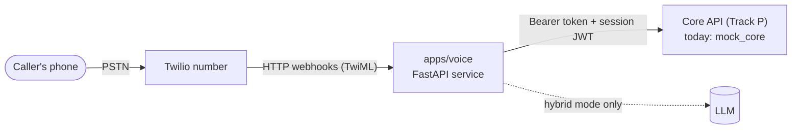
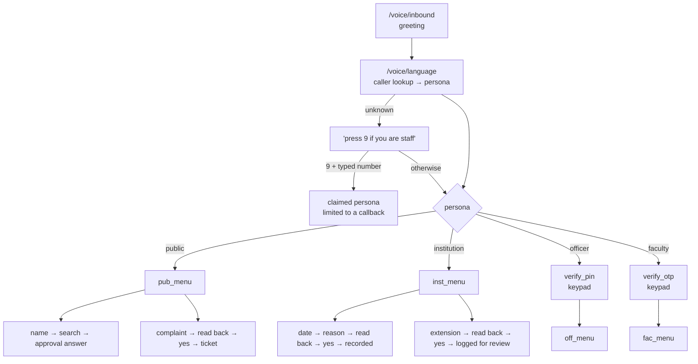

# AICTE Approval & Compliance Portal — AI Voice Agent

A phone-answering assistant for the AICTE Approval & Compliance Portal (SIH 2026, PS 26262).
People ring a phone number and talk to it; it can also be told to ring institutions about
overdue paperwork. This repository is **Track V — the voice service** (`apps/voice`). The rest of
the portal (web app, workflow engine, database — "Track P") is specified in [`app.md`](./app.md)
but is **not in this repo**; until it exists the voice service talks to a small built-in mock.

> **The short version:** by default **no OpenAI (or any LLM) is in the call path.** The
> conversation is a fixed, testable graph of questions built on Twilio's `<Gather>` speech/keypad
> input. An LLM is an optional extra for open-ended questions (`hybrid` mode) and is off unless
> you give it a key.

---

## Contents

1. [What it does](#1-what-it-does)
2. [A call, start to finish (real output)](#2-a-call-start-to-finish-real-output)
3. [How it works](#3-how-it-works)
4. [What you need (accounts, keys, tools)](#4-what-you-need-accounts-keys-tools)
5. [Try it in five minutes — no Twilio needed](#5-try-it-in-five-minutes--no-twilio-needed)
6. [Take real phone calls (Twilio + ngrok)](#6-take-real-phone-calls-twilio--ngrok)
7. [Configuration reference](#7-configuration-reference)
8. [Safety rules the code enforces](#8-safety-rules-the-code-enforces)
9. [HTTP endpoints](#9-http-endpoints)
10. [Repository layout](#10-repository-layout)
11. [Tests](#11-tests)
12. [Status: what is and is not built](#12-status-what-is-and-is-not-built)
13. [Known limitations — read before a demo](#13-known-limitations--read-before-a-demo)

---

## 1. What it does

Someone calls the number. The service works out **who they are** from the caller ID and the
(mock) core, then runs one of four conversations:

| Caller | How they're recognised | What they can do by voice |
|---|---|---|
| **Member of the public** (student, parent) | Anyone not otherwise recognised | Ask whether an institution is AICTE-approved (courses + intake); file a complaint about a fake or unapproved college and get a ticket number |
| **Institution staff** | Caller ID matches a registered contact — or an outbound call placed to them | Hear their open items and due dates; promise a completion date (a *commitment*); ask for more time (an *extension request*); get the upload link on WhatsApp / SMS / email |
| **AICTE officer** | Caller ID matches an officer, **then a 6-digit voice PIN on the keypad** | Queue summary, overdue lists (stages, undertakings, documents, visits), regional statistics, a report emailed to them, a reminder sent to an institution |
| **Faculty member** | Caller ID matches a faculty record, **then a one-time code on the keypad** | Hear their registration status and any duplicate flag with the steps to resolve it; file a grievance about their record |

Unknown callers who say they are staff can press **9** and type their registered number — but
that is only a *claim*, so such a session is limited to arranging an officer call-back.

Everywhere, the caller can say **"repeat"**, **"main menu"**, **"officer"** (an officer is asked
to call back) or **"goodbye"**.

**What it will never do:** approve, reject or change an application; grant or promise an
extension; predict an outcome; read out private data to an unverified caller. See
[§8](#8-safety-rules-the-code-enforces).

---

## 2. A call, start to finish (real output)

These transcripts are real output of the running service, driven by
[`scripts/simulate_call.py`](./apps/voice/scripts/simulate_call.py) against the mock core
(`🤖` = what the caller hears; the lines after `you>` are what the caller said or pressed).

**A parent checks a college** (unknown number → public persona)

```
🤖  Hello, this is the AICTE assistant.
🤖  How can I help? Say check an institution, or press 1. Say file a complaint, or press 2. ...
you> check an institution
🤖  Please say the name of the institution, and the city if you know it.
you> Sri
🤖  I found 2 matches.
🤖  Which one? 1: Sri Venkateswara Institute of Technology, Anantapur. 2: Sri Sai College of Engineering, Chennai. Say or press the number.
you> 2
🤖  Sri Sai College of Engineering is approved for 2026-27. Approved courses: B.Tech CSE, intake 120; B.Tech ECE, intake 60.
🤖  Is there anything else? You can check another institution, file a complaint, or say goodbye.
you> no thanks
🤖  Thank you for calling. Goodbye.
```

**An officer** (PIN is typed on the keypad, never spoken; first attempt deliberately wrong)

```
🤖  Please enter your six digit voice PIN on the keypad, then press hash.
you> #111111
🤖  That code did not match.
you> #246810
🤖  Thank you, you are verified.
you> what is in my queue
🤖  You have 14 pending, 3 overdue, and 5 due this week.
you> show me overdue undertakings
🤖  There are 3 overdue undertaking items. The first is A P P, 2 0 2 6, 0 4 0 0, 3 days overdue. Say remind to send a reminder for it.
you> remind
🤖  I will send the institution a reminder about A P P, 2 0 2 6, 0 4 0 0. Say yes to send it, or no to cancel.
you> yes
🤖  The reminder has been sent.
```

**An institution makes a commitment** (note the policy limit and the read-back before saving)

```
you> I want to record a commitment
🤖  By when will you complete Lease registration? You can say a date, like the 20th of November, or next Friday.
you> the 25th of December
🤖  Only the competent authority can grant extensions. The latest date I can record is Monday, 23 November 2026. Give me an earlier date, or say extension request and I will log it for officer review.
you> the 20th of November
🤖  Briefly, what is the reason for the timeline? You can say skip.
you> the lease registration is pending
🤖  To confirm: you will complete Lease registration by Friday, 20 November 2026. Is that correct?
you> yes
🤖  Recorded. Lease registration by Friday, 20 November 2026.
🤖  Shall I send you the upload link? Say WhatsApp, S M S, or email. Or say no.
you> send it on WhatsApp
🤖  I have sent the upload link by WhatsApp.
```

---

## 3. How it works



**Speech is handled by Twilio, not by us.** Twilio listens to the caller (speech-to-text),
reads our prompts aloud (text-to-speech), and calls our webhooks with the result. We never touch
audio. Each caller answer is one HTTP request to `POST /voice/g/turn?n=<node>`.

### The Gather graph (default, no LLM)

A *node* is one question. Its *handler* decides what to do with the answer and returns the next
node plus anything to say. Everything is plain, deterministic Python — you can read the whole
conversation in [`apps/voice/app/graph/nodes/`](./apps/voice/app/graph/nodes).



Per call, the service keeps a small in-memory record (current node, what's been collected,
whether the caller is verified). Silence is re-prompted twice then the call ends politely;
repeated misunderstanding ends in an officer call-back; a core outage is explained honestly
rather than guessed around.

### The three modes (`CONVERSATION_MODE`)

| Mode | What drives the conversation | OpenAI/LLM at call time? |
|---|---|---|
| **`gather`** *(default)* | The deterministic graph above | **No** |
| `relay` | An LLM writes every reply, over Twilio ConversationRelay (a WebSocket) | Yes — needs `LLM_API_KEY` |
| `hybrid` | The graph leads. If it can't understand the caller after a few tries (or has a rules question), the call is handed to the LLM relay; saying "main menu" returns to the graph. A caller already verified by the graph is *not* asked for their PIN again | Only as a fallback, and only if `LLM_API_KEY` is set. Without a key `hybrid` behaves like `gather` |

Even in `relay`/`hybrid`, the LLM is fenced in by code (the same policy rules as the graph;
see [§8](#8-safety-rules-the-code-enforces)): it cannot see tools the caller isn't cleared for,
cannot save anything without a spoken "yes", and never sees PINs or one-time codes.

Post-call summaries (a later phase) are the one other place an LLM may be used — after the call
has ended, not during it.

---

## 4. What you need (accounts, keys, tools)

### Just to try it on your laptop — **nothing but Python**

| Need | Notes |
|---|---|
| **Python 3.12** | Not 3.13. On Windows, if `python` isn't found, call the interpreter by its full path or add it to PATH |
| That's it | No Twilio, no ngrok, no OpenAI. The built-in mock core stands in for the real backend and `simulate_call.py` stands in for the phone |

### To take real phone calls (default `gather` mode)

| # | What | Where you get it | Goes in |
|---|---|---|---|
| 1 | **A Twilio account** (a free trial is enough to start) | twilio.com/try-twilio | – |
| 2 | **A voice-capable Twilio phone number** | Twilio Console → Phone Numbers → Buy a number (trial credit covers one). Check the number type is supported for your country; calling a US number from India is an international call | the number's webhook settings (§6), no env var needed yet |
| 3 | **Twilio Auth Token** | Twilio Console → Account Info → *Auth Token* (click to reveal) | `TWILIO_AUTH_TOKEN` — used to verify webhooks really came from Twilio |
| 4 | **A public HTTPS URL to your laptop** — **ngrok** *or* cloudflared | ngrok.com → sign up → *Your Authtoken* in the dashboard. (Free ngrok accounts can claim one free static domain, which saves re-pasting URLs every restart) | `ngrok config add-authtoken <token>` (stored by ngrok, not in this project) and then `PUBLIC_VOICE_URL=https://<your-domain>` |
| 5 | **Secrets you invent** | Run `python -c "import secrets; print(secrets.token_urlsafe(32))"` once per value | `INTERNAL_SERVICE_TOKEN`, `SESSION_JWT_SECRET`, `CALLER_HASH_PEPPER` (and `ADMIN_API_KEY` in production only) |

**You do not need:** an OpenAI key (default mode), a Twilio *Account SID* or API keys (the
service only *answers* calls for now; it doesn't call the Twilio REST API yet), Redis, a
database.

### Only if you switch on the LLM (`relay` / `hybrid`)

| What | Where | Goes in |
|---|---|---|
| An OpenAI-compatible API key | platform.openai.com → API keys | `LLM_API_KEY` (model: `LLM_MODEL`, default `gpt-4o-mini`) |

### Later phases (not wired up yet)

| What | For |
|---|---|
| Twilio **Account SID** + the number in E.164 form | **Outbound** calls ("we're calling about your overdue lease") — phase V4. On a trial account you can only dial numbers you've verified in the Twilio console |
| Twilio SMS sender | Texting ticket numbers / upload links |
| The real core API's URL and token | Replacing the mock (Track P, phase P8) |
| Production secrets + a deployment host | Phase V7 |

> **Never commit real keys.** `.env` files are in `.gitignore`. This repository is **public**.
> If a key is ever pasted into a commit, rotate it immediately.

---

## 5. Try it in five minutes — no Twilio needed

All commands run from `apps/voice`. (PowerShell shown; use `source .venv/bin/activate` on macOS/Linux.)

```powershell
cd apps/voice
python -m venv .venv                       # use the full path to python 3.12 if `python` isn't found
.\.venv\Scripts\pip install -e ".[dev]"

# Terminal 1 — the stand-in for the real backend (port 9000)
.\.venv\Scripts\python -m uvicorn mock_core.app:app --port 9000

# Terminal 2 — the voice service (port 8080). Signature checks off: only for local testing.
$env:TWILIO_SIGNATURE_VALIDATION_ENABLED = "false"
.\.venv\Scripts\python -m uvicorn app.main:app --port 8080

# Terminal 3 — pick up the phone
.\.venv\Scripts\python scripts/simulate_call.py --from +919999999999   # a member of the public
```

The mock core recognises these caller numbers (match on the last four digits):

| `--from` | Persona | Notes |
|---|---|---|
| `+910000000001` | Institution | one open item: *Lease registration* |
| `+910000000002` | Officer | PIN is **`246810`** — type it as `#246810` |
| `+910000000003` | Faculty | one-time code is **`123456`** — type it as `#123456` |
| anything else | Public | try *Sri*, *Sri Venkateswara*, or a nonsense name |

In the simulator, type a sentence to *speak* it, `#123456` to *press keypad digits*, `/silence`
to stay quiet, `/quit` to hang up. Check the service is up with `curl localhost:8080/health`.

---

## 6. Take real phone calls (Twilio + ngrok)

1. **Install & configure.** Do the install from §5, then
   `copy .env.example .env` (in `apps/voice`) and fill in `TWILIO_AUTH_TOKEN`, the three
   invented secrets, and leave `TWILIO_SIGNATURE_VALIDATION_ENABLED=true`.
2. **Start the backend stand-in and the service** (terminals 1 and 2 from §5, *without* the
   `$env:TWILIO_SIGNATURE_VALIDATION_ENABLED = "false"` line).
3. **Expose it:**
   ```powershell
   ngrok config add-authtoken <your-ngrok-authtoken>   # once
   ngrok http 8080                                     # with a static domain: ngrok http --url=<your-domain> 8080  (older ngrok: --domain)
   ```
   Copy the `https://….ngrok-free.app` address into `PUBLIC_VOICE_URL` in `.env` and
   **restart the voice service**. This must match exactly what you give Twilio — signatures are
   computed over that host. (Free random ngrok URLs change on every restart; a static domain
   avoids repeating this.)
4. **Point the Twilio number at it.** Twilio Console → Phone Numbers → *your number* → Voice
   Configuration:
   - *A call comes in* → **Webhook**, `POST`, `https://<your-url>/voice/inbound`
   - *Call status changes* → `POST`, `https://<your-url>/voice/status`
5. **Call the number.** You should hear the greeting and the menu. Watch the service terminal:
   it logs each step as JSON (never phone numbers, PINs or what you said).

**On a Twilio trial account** callers may hear a short Twilio announcement before your service answers (check Twilio's trial-account notes).
**If calls fail:** `403` in the logs means the signature check failed — usually
`PUBLIC_VOICE_URL` doesn't match the URL in the Twilio console, or the Auth Token is wrong;
Twilio Console → Monitor → Logs → Errors shows what Twilio saw.

---

## 7. Configuration reference

Settings come from environment variables or `apps/voice/.env`. The full annotated list is
[`apps/voice/.env.example`](./apps/voice/.env.example). The ones that matter:

| Variable | Default | Meaning |
|---|---|---|
| `CONVERSATION_MODE` | `gather` | `gather` · `relay` · `hybrid` ([§3](#the-three-modes-conversation_mode)) |
| `ENABLED_LANGUAGES` | `en` | English only. `en,hi,te,ml,ta,kn` restores the six-language menu (Indian-language speech quality is unverified) |
| `PUBLIC_VOICE_URL` | `http://localhost:8080` | Public https URL Twilio reaches; signature checks use it |
| `TWILIO_AUTH_TOKEN` | – | Verifies webhooks |
| `TWILIO_SIGNATURE_VALIDATION_ENABLED` | `true` | Turn off only for local `curl`/simulator use. Production refuses to boot with it off |
| `CORE_BASE_URL` | `http://localhost:9000/internal/voice` | The core API (or the mock) |
| `INTERNAL_SERVICE_TOKEN` | placeholder | Bearer token sent to core. Production refuses the placeholder |
| `SESSION_JWT_SECRET` | derived | Signs per-call session tokens |
| `CALLER_HASH_PEPPER` | dev value | Phone numbers are stored only as HMAC hashes; production refuses the dev value |
| `LLM_API_KEY` / `LLM_MODEL` | – / `gpt-4o-mini` | Only for `relay` / `hybrid` |
| `COMMITMENT_MAX_DAYS` | `30` | Furthest date a caller may *commit* to; anything later can only be an extension *request* |
| `PIN_MAX_ATTEMPTS` / `OTP_MAX_ATTEMPTS` | `3` | Wrong codes before the call is ended |
| `PUBLIC_LOOKUPS_PER_CALL` / `PUBLIC_CALLS_PER_DAY` | `5` / `10` | Abuse limits for anonymous callers |
| `NO_INPUT_TIMEOUT_MS`, `SILENCE_REPROMPTS` | `6000`, `2` | Silence handling |
| `MAX_CALL_DURATION_PUBLIC_SEC` / `…_DEFAULT_SEC` | `360` / `600` | Call length caps |

---

## 8. Safety rules the code enforces

These are enforced in Python, not just asked of a model, so they hold in every mode.
(Code: [`agent/policy.py`](./apps/voice/app/agent/policy.py), [`agent/verification.py`](./apps/voice/app/agent/verification.py), [`agent/guardrails.py`](./apps/voice/app/agent/guardrails.py).)

- **No decisions.** "Approve my application" is refused deterministically (without any LLM), and an officer is asked to follow up. The service can only *record* things for humans to act on.
- **PINs and one-time codes are keypad-only.** They are collected as keypad digits, sent straight to core, forgotten immediately, and never logged, stored in the transcript, or shown to a model. Spoken attempts are told to use the keypad. Three wrong tries end the call.
- **Nothing private before verification.** Officers (PIN) and faculty (one-time code) can reach only generic help until verified. A caller identified merely by a typed number gets a call-back offer and nothing else.
- **Read back, then "yes".** Commitments, extension requests, reminders and complaints are only saved after the caller has heard the exact details and said yes. A "no", or anything ambiguous, saves nothing.
- **Date policy.** A commitment date must be a real future date within 30 days. A longer ask can only become an *extension request* for officer review, and the caller is told plainly that only the competent authority can grant extensions.
- **Public callers are rate-limited** (lookups per call, calls per number per day) and only ever receive public information.
- **Identity can't be forged by wording.** A faculty member's id comes from the call's signed session, not from anything said; every webhook must carry a valid Twilio signature.
- **Honest failures.** If the backend is down the caller is told so and offered a call-back; the service never invents an answer.
- **Privacy in logs.** Phone numbers are hashed; logs and stored transcripts redact phone numbers and digit runs.

---

## 9. HTTP endpoints

| Endpoint | Called by | Purpose |
|---|---|---|
| `GET /health` | you / load balancer | Liveness; reports if core is reachable |
| `POST /voice/inbound` | Twilio (number's *A call comes in*) | Greeting; then language step |
| `POST /voice/language` · `/identify` · `/identify-number` · `/connect` | Twilio | Caller lookup, the "press 9" flow, persona routing, session creation |
| `POST /voice/g/turn?n=<node>` | Twilio | One caller answer in the Gather graph |
| `POST /voice/g/resume` | Twilio | Back to the graph after an LLM-relay detour (hybrid) |
| `POST /voice/status` · `/voice/recording` | Twilio | Call status and recording callbacks, forwarded to core |
| `WS /voice/relay` | Twilio ConversationRelay | LLM conversation (`relay`/`hybrid` only) |

The contract with the core API is in [`app.md`](./app.md) §13.13 and the tool list in
[`packages/contracts/voice-tools.json`](./packages/contracts/voice-tools.json).

---

## 10. Repository layout

```
app.md                     the full product spec (all tracks); this repo implements Track V
docs/DECISIONS.md          every judgement call made where the spec was silent — read this
docs/CHANGELOG.md          what each phase added
packages/contracts/        voice-tools.json — the tool list shared with the core API
apps/voice/
  app/
    main.py                app factory, startup checks
    api/                   HTTP routes (voice, graph, health, Twilio signature check)
    graph/                 THE Gather graph: engine, state, TwiML rendering, nodes/{public,institution,officer,faculty,verify}
    agent/                 policy, verification, tool layer, personas; plus the optional LLM brain/guardrails
    relay_ws.py            ConversationRelay WebSocket (relay/hybrid)
    speech/                date & time parsing, yes/no detection, phrases, languages
    ivr.py · twiml.py      caller lookup / persona routing / TwiML builders
    core_client.py         talks to the core API (bearer token, circuit breaker)
    session.py · config.py signed session tokens · settings
  mock_core/               stand-in for the real core API
  scripts/simulate_call.py console "phone"
  tests/                   unit + end-to-end tests
  .env.example             every setting, annotated
```

---

## 11. Tests

```powershell
cd apps/voice
.\.venv\Scripts\python -m pytest          # about 220 tests, under a minute
.\.venv\Scripts\ruff check .              # lint
```

The end-to-end tests ([`tests/integration/test_graph.py`](./apps/voice/tests/integration/test_graph.py))
use a fake phone that follows the TwiML exactly as Twilio would, against the mock core. In
`gather` mode the test LLM is a stub that **fails the test if anything calls it** — that is the
proof that OpenAI is not in the call path. The same suite covers the voice test-matrix from the
spec (`app.md` §20.1) for public, institution, officer and faculty callers.

What the tests do **not** prove: how Twilio's real speech recognition handles Indian accents, how the TTS voices sound,
or anything about the real core API. See the next sections.

---

## 12. Status: what is and is not built

| Phase (spec §20) | State |
|---|---|
| V0 setup · V1 inbound IVR · V2 relay + LLM brain · V3 personas & tools | **Built**, plus the Gather graph (no-LLM default) |
| V4 outbound dialer (placing calls, calling hours, answering-machine detection, retries) | **Not built.** The *conversation* for an outbound call exists and is tested, but nothing places the call yet |
| V5 post-call summary + structured outcome sent to core | Not built (transcripts are collected in memory, then dropped) |
| V6 in-app dictation for field inspectors | Not built |
| V7 real-core integration, load test, deployment | Not built |
| Track P (web app, workflows, database, the real core API) | Not in this repo — specified in `app.md` |

---

## 13. Known limitations — read before a demo

- **Never tested on a real call.** Everything is verified against simulated Twilio traffic. First live calls may reveal tuning needs. Two specific unknowns: the exact Twilio `<Gather>` options best suited to Indian-English speech (`speechModel`, `enhanced`, `bargeIn` — try `GATHER_SPEECH_MODELS_JSON` to override), and how the Google `en-IN` voices sound.
- **Speech recognition is Twilio's.** Names of colleges and unusual dates are the likeliest misrecognitions — which is why every date and every filed item is read back for a yes/no before it's saved.
- **English only.** Hindi and the four southern languages are written but switched off (`ENABLED_LANGUAGES`); their speech quality and translations were never reviewed by a native speaker.
- **The backend is a mock.** Data shown above (colleges, queue numbers) comes from `mock_core`. A few places assume contract details Track P hasn't confirmed — listed in `docs/DECISIONS.md` (e.g. addressing calls by Twilio's CallSid).
- **State is in memory.** A restart mid-call makes the caller hear "technical problem" and hang up; the daily-call limit and per-call state are per-process, so run **one** worker until they move to Redis.
- **Call-back promises are only as real as core.** "I've asked an officer to call you back" means a task was sent to core; whether an officer sees it depends on Track P.
- **Trial limits.** A Twilio trial account may add an announcement to calls and, once outbound calling exists, can only dial numbers you have verified in the Twilio console.
